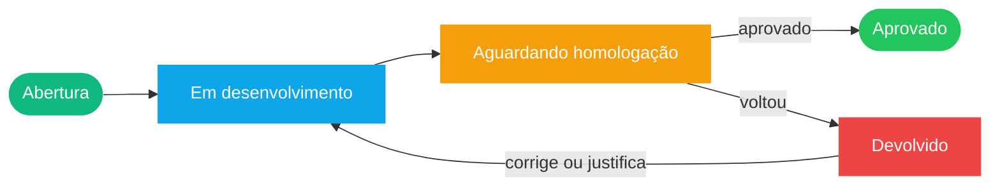

<div align="center">


<br/>


<br/>

<a href="https://github.com/PedroWenner"></a>
<a href="https://training.alcati.com.br/"></a>
<a href="mailto:pedro_wenner@outlook.com"></a>

</div>


## `> sobre_mim.yaml`

```yaml
nome: "Pedro Wenner Lemes Alcantara"
usuario: "PedroWenner"
cargo: "Desenvolvedor Full Stack"
backend: ["C#", ".NET", "ASP.NET Web Forms", "Entity Framework 6", "PHP", "Node.js"]
frontend: ["JavaScript", "TypeScript", "Bootstrap 5", "PWA"]
banco_de_dados: ["SQL Server", "T-SQL"]
devops: ["Azure DevOps", "Git", "PowerShell", "Python"]
foco: "sistemas de gestão previdenciária multi-cliente"
hobby: "PWAs, blogs e ferramentas internas do zero"
status: "refatorando legado e automatizando rotina 24/7"
```


## `> stack.exe`

<div align="center">


<br/>


<br/>


<br/>


</div>


## `> projetos.json`

<table>
<tr>
<td width="50%" valign="top">

#### 🧭 Workspace SISPREV

```json
{
  "tipo": "ferramentas internas",
  "stack": ["Node.js", "PowerShell", "Python"],
  "dependencias": 0,
  "banco": "read-only por padrão"
}
```

Organiza o histórico de cada chamado e automatiza tarefas de banco e de branch.

</td>
<td width="50%" valign="top">

#### 💪 Vida Forte (Training-Life)

```json
{
  "tipo": "PWA",
  "stack": ["JavaScript", "Service Worker"],
  "dependencias": 0,
  "offline": true
}
```

Treino, dieta e evolução em 12 semanas. [🔗 Demo](https://training.alcati.com.br/) · [📦 Repo](https://github.com/PedroWenner/Training-Life)

</td>
</tr>
</table>

| Módulo | O que faz | Stack |
|:--|:--|:--|
| 📋 **Painel de Chamados** | Dashboard local ao vivo: status, pendências, filtros, devolutivas e diário de bordo |  |
| 📄 **Caderno de validação** | Gera o `caderno-validacao.yml` no repositório certo, já preenchido |   |
| ⬆️ **Enviar para estágio** | Cria a branch do próximo estágio e faz o merge, sem commit nem push |  |
| 🗄️ **ConsultaBanco** | CLI SQL Server com alerta de produção e exportação CSV |  |
| 🔁 **Sync / Promote** | Promove views, procs e functions entre ambientes com **merge de 3 vias** |  |
| 🔍 **Compare Objetos** | Compara dois bancos e mostra só o que difere |  |
| 📚 **Documentação** | Padrão de código, 45 boas práticas de Code Review e MasterPage Bootstrap 5 |  |




## `> repositorios.md`

| Repositório | Descrição | Linguagem |
|:--|:--|:--|
| [**AlcatechRH-**](https://github.com/PedroWenner/AlcatechRH-) | Sistema de RH |  |
| [**SIGES**](https://github.com/PedroWenner/SIGES) | Sistema de gestão |  |
| [**AlcaStock**](https://github.com/PedroWenner/AlcaStock) | Controle de estoque |  |
| [**Training-Life**](https://github.com/PedroWenner/Training-Life) | PWA Vida Forte |  |
| [**financas**](https://github.com/PedroWenner/financas) | Controle financeiro |  |
| [**OpenCutList**](https://github.com/PedroWenner/OpenCutList) | Plano de corte |  |
| [**meu-blog**](https://github.com/PedroWenner/meu-blog) | Meu blog |  |
| [**Doceria**](https://github.com/PedroWenner/Doceria) | Site de doceria |  |
| [**RouletteGaming**](https://github.com/PedroWenner/RouletteGaming) | Jogo de roleta |  |


## `> boas_praticas.sh`

```bash
# codigo
alteracoes_pontuais=true       # escopo minimo, sem inflar metodos
try_catch_em_todo_metodo=true
reaproveitar_antes_de_criar=true

# dados
acesso_a_dados="EF6 + AsNoTracking()"
scripts_sql="idempotentes e numerados"
ambientes_protegidos="somente leitura"
encoding_legado="cp1252"

# entrega
pull_request="TIPO/CH000000 - TITULO"
apos_code_review="squash"
commit_e_push_automaticos=false
```


## `> stats.log`

<div align="center">


</div>


